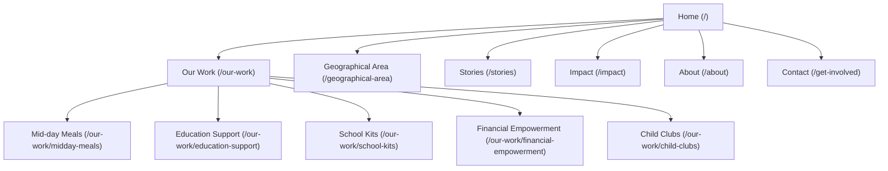

# Heart of Nepal — Website Rebuild (VVS Design System)

Rebuild the Heart of Nepal website as a modern, premium Next.js application. This plan fuses the 100% complete content from our Wix site research with the high-contrast, clinical-precision **VVS Design System** defined in `DESIGN.md`.

---

## User Review Required

> [!IMPORTANT]
> We are using a premium, high-contrast light mode design system featuring:
> - **Primary Canvas:** Stark `Pure White` (`#ffffff`) background with solid `Charcoal Black` (`#18181b`) text.
> - **Accent Colors:** Single vivid `Vermillion Accent` (`#fc5f2b`) for CTAs and highlights, with subtle elements featuring a warm `Sunset Gradient` and soft yellow highlights (`Canary Yellow` `#ffdd61`).
> - **Typography:** Monochromatic layout using **Inter** (substitute for Nb International Pro) with tight letter-spacing for headings and **Space Mono** (substitute for Nb International Mono Pro) for technical details and stats.
> - **Shapes & Borders:** Generous 9999px pill-shaped buttons and inputs with sharp clinical borders (`#e4e4e7`).

---

## Proposed Changes

### Design System & Layout Configuration

#### [MODIFY] [globals.css](file:///Users/prabinsharma/hearts-of-nepal/app/globals.css)
- Define standard VVS CSS custom properties (`--color-charcoal-black`, `--color-vermillion-accent`, `--font-nb-international-pro-webfont`, etc.).
- Establish the Nb International Pro typography scale (Inter substitute) and Mono Scale (Space Mono substitute).
- Set layout utilities: `--section-gap` (64px to 96px), `padding` tokens, subtle card shadows.
- Define premium pill button styles (`.btn-primary` using `#fc5f2b`, `.btn-secondary` outline, `.btn-ghost-light`).

#### [MODIFY] [layout.tsx](file:///Users/prabinsharma/hearts-of-nepal/app/layout.tsx)
- Embed the sticky clinical navigation header with the **Heart of Nepal** logo.
- Integrate the global VVS footer containing the newsletter subscription form, contact info, and Instagram link.
- Anchor the bottom-right of the viewport with the VVS **Floating Chat Widget Trigger** (rounded square containing 'S' brand-mark).

---

### Page Routes & Visual UX Structure

Each page is designed to highlight evidence-backed social impact metrics with technical, high-contrast precision.



#### [NEW] [page.tsx](file:///Users/prabinsharma/hearts-of-nepal/app/page.tsx) — Homepage
- **Hero:** Full-bleed moody background image overlayed with bold display typography (`60px`, `-0.3px` letter spacing) reading: `"Get better at building healthier communities, every year."`
- **Pill CTAs:** "Become a Member" (Vermillion) and "See How It Works" (Outline).
- **Hero Metrics:** Space Mono styled numbers (`1,200+`, `340+`, `80+`) showcasing immediate scope.
- **Why We Exist:** High-contrast two-column section detailing structural caste- and gender-based exclusions.
- **Model of Change:** 3 pillars (Educate, Nourish, Empower) represented via premium image wrapper cards.

#### [NEW] [about/page.tsx](file:///Users/prabinsharma/hearts-of-nepal/app/about/page.tsx) — About
- **Hero:** Bold founding story of Aishworya Shrestha (founder, Globethics Youth Leadership Award winner).
- **Core Values:** "Community Ownership", "Intersectional Justice", "Ethical Partnerships".
- **Mission List:** 5 clinical goals styled in Space Mono list format.

#### [NEW] [geographical-area/page.tsx](file:///Users/prabinsharma/hearts-of-nepal/app/geographical-area/page.tsx) — Geographical Area
- Deep-dive into **Sindupalchowk District** and **Indrawati Rural Municipality**.
- Population metrics (`287,798`), ethnic statistics (`Tamang 24.25%`), earthquake damage overview.
- Clean VVS layout showing regional stunting figures, and the complete history of previous NGO interventions.

#### [NEW] [stories/page.tsx](file:///Users/prabinsharma/hearts-of-nepal/app/stories/page.tsx) — Ground Stories
- Comprehensive first-person narratives mapping community success:
  1. **Lalita Gurung's Journey** (Majhi) from housewife to chicken poultry entrepreneur (NPR 8,400 + NPR 4,000 generated).
  2. **Laju Majhi's Journey** (10-year-old) to educational tuition support.
- Rendered in elegant blockquotes using Playfair Display font accents for quote sections.

#### [NEW] [our-work/page.tsx](file:///Users/prabinsharma/hearts-of-nepal/app/our-work/page.tsx) — Our Work Overview
- Interactive dashboard grid of programs.
- Each program has an **Image Wrapper Card** (5px border-radius, minimum padding) with program details.

#### [NEW] [our-work/[program]/page.tsx](file:///Users/prabinsharma/hearts-of-nepal/app/our-work/midday-meals/page.tsx) — Program Pages
Individual pages for Mid-day Meals, Education Support, School Kits, Financial Empowerment, and Child Clubs:
- **Hero Header:** Technical stats header (e.g. `730,000+ meals served`).
- **Narrative Section:** Explains structural barriers (e.g., stunting data from Demographics Survey).
- **Image Grid:** Premium image carousel/grid showcasing real-world photos.
- **CTA:** Highly actionable donation banner (`Offer a meal / school kit / training`).

#### [NEW] [impact/page.tsx](file:///Users/prabinsharma/hearts-of-nepal/app/impact/page.tsx) — Impact Dashboard
- Precision table structure tracking Women's Self-Help Groups (Pipaltar Mother's Group, Battar Mother's Group) and savings details.
- High-contrast card layouts mapping educational Kit distribution milestones.

#### [NEW] [get-involved/page.tsx](file:///Users/prabinsharma/hearts-of-nepal/app/get-involved/page.tsx) — Get Involved / Contact
- Branded form layout with inputs using VVS tokens (`11.24px` border-radius inputs).
- Interactive submit button (Vermillion Accent, 9999px border-radius).

---

## Verification Plan

### Build & Compilation
```bash
npm run build
```
- Must compile with zero TypeScript or Next.js build errors.

### Visual & Interactive QA
- Verify navigation bar stickiness and dropdown menu behavior.
- Validate custom typography scale (Inter/Space Mono rendering).
- Test form responsiveness and inputs.
- Ensure all 55 downloaded images load seamlessly from `/public/assets/`.
